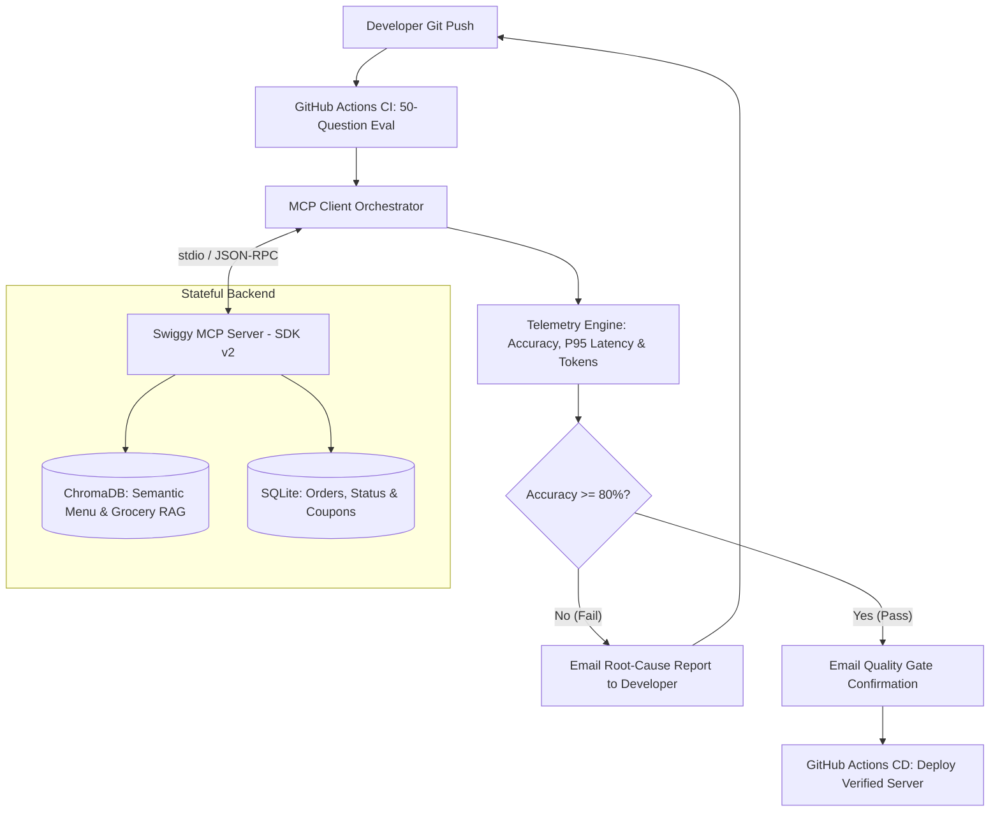

# Swiggy MCP Server & Automated Evaluation Pipeline

A production-style **Model Context Protocol (MCP)** server (built on MCP Python SDK v2) for Swiggy Food & Instamart workflows, paired with a **50-question deterministic evaluation engine** and a **closed-loop GitHub Actions CI/CD quality gate**.

---

## Project Overview

LLM agents connected to external tools often fail silently when tool descriptions overlap (e.g., ordering raw groceries vs. cooked meals, or cancelling an active order vs. refunding a delivered one). 

This project solves that problem through **Eval-Driven MCP Development**:
1. **Stateful MCP Server (`src/mcp_server.py`):** Exposes 8 domain tools backed by **SQLite** (transactional order/coupon state) and **ChromaDB** (semantic RAG search over dishes and groceries).
2. **Custom MCP Client (`src/mcp_client.py`):** Orchestrates multi-step tool chaining over `stdio` transport with structured logging, latency profiling, and token observability.
3. **50-Question Golden Benchmark (`evals/evaluate.py`):** Evaluates direct, ambiguous, multi-step, and edge-case queries with full SQLite state isolation between tests.
4. **Automated CI/CD Quality Gate (`.github/workflows/mcp-cicd.yml`):** Blocks deployment and emails a root-cause diagnostic report to the developer if tool-selection accuracy drops below **80%**.

---

## System Architecture



---

## Benchmark Results (`v1` Baseline vs. `v2` Optimized)

Evaluated across **50 realistic Swiggy queries** (`25 Direct`, `15 Ambiguous`, `5 Multi-Step Chained`, `5 Edge Cases`) using `openai/gpt-oss-20b`:

| Metric | `v1` Baseline (Minimal Docstrings) | `v2` Optimized (Schema Boundaries + Guardrails) | Impact |
| :--- | :--- | :--- | :--- |
| **Correct Tool Accuracy** | 42 / 50 (**84.0%**) | 46 / 50 (**92.0%**) | **+8.0% Accuracy** |
| **Wrong / Redundant Tool Calls** | 8 / 50 (**16.0%**) | 4 / 50 (**8.0%**) | **-50% Error Rate** |
| **Runtime Tool Failures** | 0 / 50 (**0.0%**) | 0 / 50 (**0.0%**) | 100% Schema Valid |
| **Avg End-to-End Latency** | 4,683.06 ms | 6,216.49 ms* | *Includes free-tier 429 retries |
| **P95 Latency** | 7,510.47 ms | 13,859.45 ms* | *Includes free-tier 429 retries |
| **Total Tokens (50 Queries)** | 68,988 tokens | 111,992 tokens | +62% schema context |
| **CI/CD Cost per Run** | **\$0.00** | **\$0.00** | Groq Free Tier |
| **Quality Gate Status (≥80%)** | PASSED | **PASSED ✅** | Ready for CD |

---

## Repository Structure

```text
swiggy-mcp-server-eval/
├── .github/workflows/
│   └── mcp-cicd.yml          # Closed-loop CI/CD pipeline + SMTP email alerts
├── src/
│   ├── database.py           # SQLite transactional database + test isolation reset
│   ├── vector_store.py       # ChromaDB semantic search for Food & Instamart
│   ├── mcp_server.py         # 8 Swiggy MCP tools with Pydantic & safety guardrails
│   └── mcp_client.py         # Async MCP client with multi-step tool chaining
├── evals/
│   ├── dataset_50.json       # 50-question golden evaluation benchmark
│   └── evaluate.py           # Deterministic evaluator & threshold gate
├── docs/
│   └── DECISIONS.md          # Architectural trade-offs & root-cause failure log
└── requirements.txt
```

---

## Quickstart (Run Locally)

```bash
# 1. Clone & activate virtual environment
git clone https://github.com
cd swiggy-mcp-server-eval
python -m venv venv
venv\Scripts\activate  # Windows

# 2. Install dependencies
pip install -r requirements.txt

# 3. Add your Groq API key to .env
echo "GROQ_API_KEY=your_key_here" > .env

# 4. Run the 50-question evaluation benchmark
python evals/evaluate.py
```

---

## Technical Rationale & Trade-offs

See [`docs/DECISIONS.md`](docs/DECISIONS.md) for detailed architectural decisions, model selection rationale, and root-cause debugging logs.
